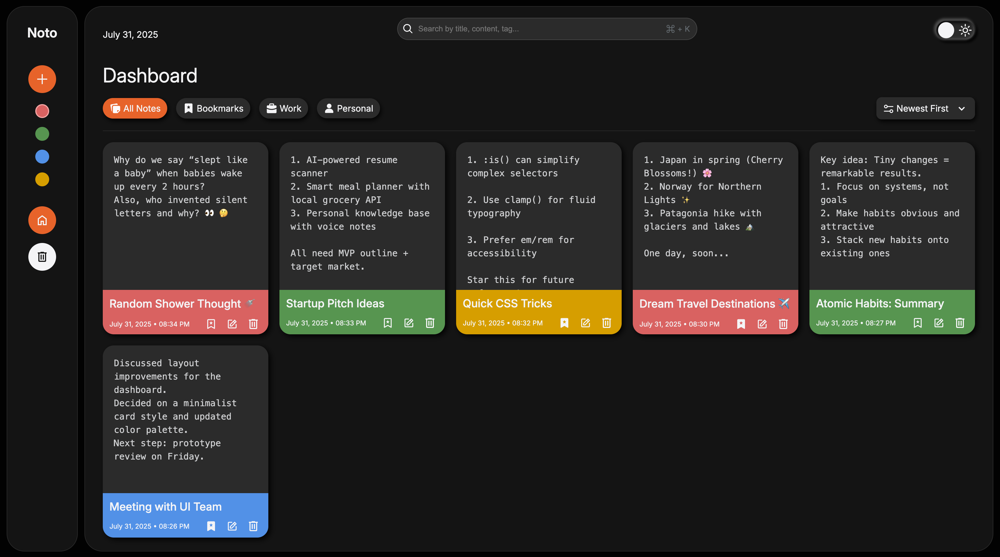
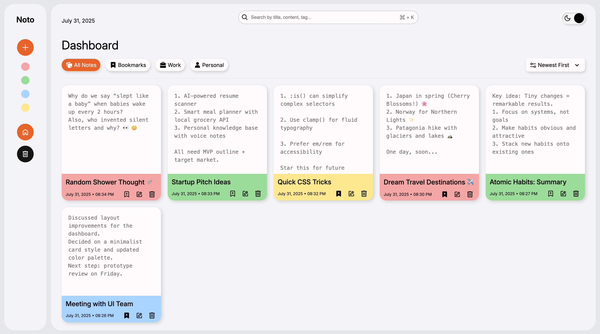

# 📝 NoteFlow v0 (The Vanilla Foundation)

[](https://developer.mozilla.org/en-US/docs/Glossary/HTML5)
[](https://developer.mozilla.org/en-US/docs/Web/CSS)
[](https://developer.mozilla.org/en-US/docs/Web/JavaScript)

    
 

## 🌍 Live Preview  
[Launch NoteFlow v0](https://prateek1789.github.io/Notes-App/v0-vanilla/) 

## 📖 About This Version

Version 0 of NoteFlow is the foundational build of this monorepo. Before introducing reactive frameworks or backend databases, this version was engineered from scratch using **pure Vanilla JavaScript, HTML, and CSS**. 

The primary goal of this iteration was to demonstrate a strong command of the Document Object Model (DOM), browser APIs, and Object-Oriented Programming (OOP) principles by building a robust Single Page Application (SPA) without any external dependencies.

## ✨ Core Features

* **Complete Data Management:** Full Create, Read, Update, and Delete (CRUD) operations.
* **Stateful Deletion:** Implements both "Soft Delete" (moves to Trash) and "Hard Delete" (permanent removal) functionality.
* **Smart Organization:** Tagging system categorizing notes into *All Notes*, *Bookmarks*, *Work*, and *Personal*.
* **Advanced Search & Filtering:** * Tab-aware search functionality scanning by Title, Content, and Tags.
* Sorting algorithms to arrange notes by *Newest First* or *Oldest First*.
* **Dedicated Views:** Separate Dashboard view for active notes and a Trash view for soft-deleted items.

## 🏗️ Architecture & Project Structure 

Instead of a single monolithic script file, the JavaScript logic is heavily modularized using strict **Object-Oriented Programming (OOP) classes** to separate concerns:  

```text
v0-Vanilla/
│
├── assets/              
├── JS/
│   ├── Data/
│   ├── DataModel/
│   ├── Manager/
│   ├── UI/
│   ├── Utils/
│   └── app.js
│          
├── index.html            
├── README.md                 
└── styles.css                     
```

## 💾 Storage Mechanism 

Being a pure frontend exercise, NoteFlow v0 utilizes the browser's native LocalStorage API to persist user data. All state management and JSON serialization/deserialization is handled entirely on the client side, ensuring immediate load times and offline availability.